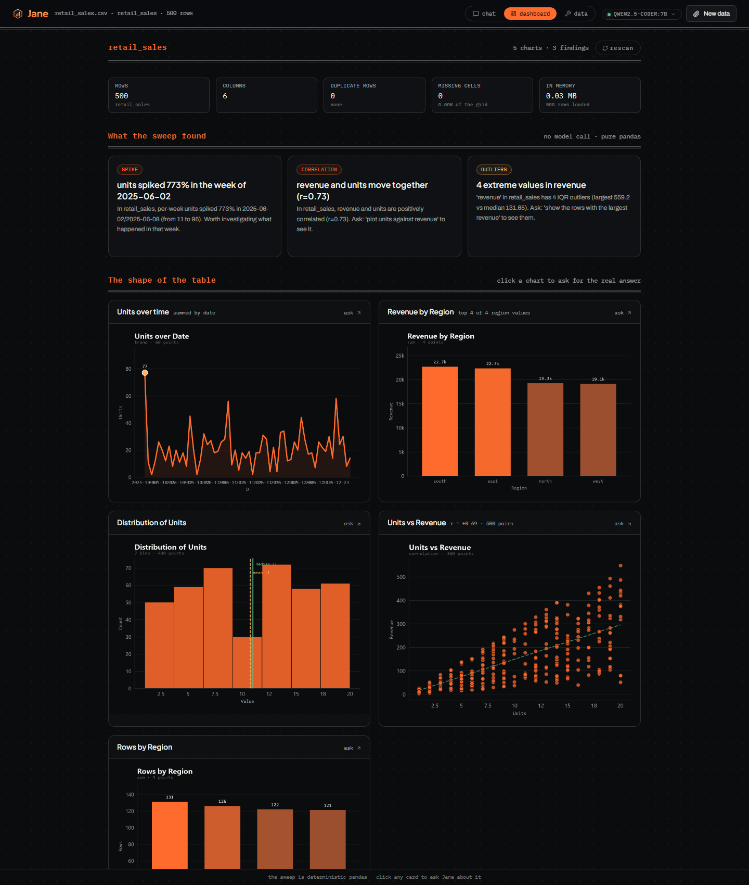
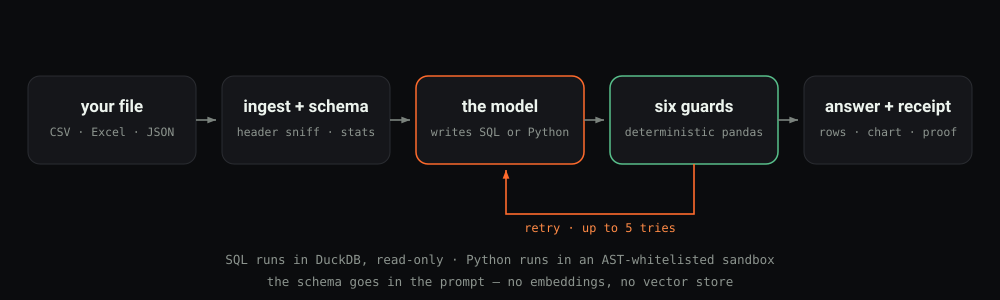
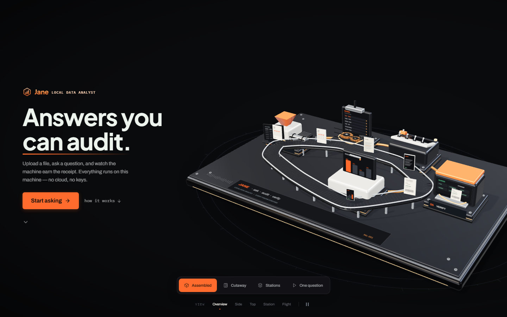
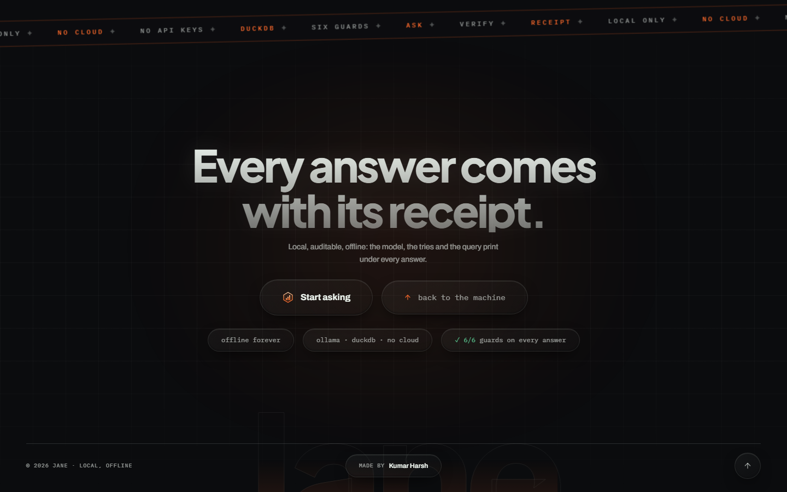

<!-- The centred blocks are written as plain HTML on purpose: markdown nested
     inside a raw HTML block is not guaranteed to be parsed, and a header that
     renders as literal asterisks on GitHub is a bad first impression. -->
<div align="center">


<b>Ask your CSV, Excel, JSON or Parquet files questions.</b><br>
Get answers you can audit.

<br>

<a href="https://github.com/kumarharshzzz04/jane"></a>
<a href="https://github.com/kumarharshzzz04/jane"></a>
<a href="https://github.com/kumarharshzzz04/jane"></a>
<a href="https://github.com/kumarharshzzz04/jane"></a>
<a href="https://github.com/kumarharshzzz04/jane"></a>

</div>

> **The interface is private, on purpose.** The React 19 app in the screenshots is the
> part I am proudest of — and the easiest thing to copy — so it lives in a private repo
> and is shared on request. Everything that makes Jane answer is here: the Python
> package, the FastAPI/SSE bridge, the six guards, the eval harnesses and the original
> Streamlit UI. None of it needs the React app to run.

Jane runs a **fully local LLM** (Ollama) over your files. No cloud, no API keys,
no data leaving the machine — the only network hop is localhost.

It is not a chatbot with a database bolted on. Every answer ships with a
**verification receipt**: the query that ran, the rows it returned, and six
deterministic guards that check the numbers *before* you see them.

```text
model qwen2.5-coder:7b · tries 1 · guards passed 6/6 · verified ✓
```

That line is not decoration. It is the output of the guards listed below, and it
sits under every answer the app gives. When the six cannot verify a reply, Jane
says so instead of guessing.



*The dashboard is computed, not generated — pure pandas, no model call, so it
comes out the same every time. Any card or panel is one click from a verified
answer.*

## What you get

| Screen | What it does |
|---|---|
| **Chat** | Ask in English; get the SQL or Python that ran, the rows it returned, a styled chart, and a receipt. |
| **Dashboard** | Deterministic insight cards and a chart grid built without a model call. Click any card to ask the real question. |
| **Data → Prep** | Ten one-click cleaning actions plus a tidy preset — fill missing, dedupe, clean whitespace, coerce dates, scale, one-hot, clamp outliers. Every action writes a **new** table; the original is never touched. |
| **Model picker** | Any installed Ollama model, chosen from the header, remembered per browser, validated server-side. |
| **Analyst brief** | The three sharpest questions on your table, answered in sequence, each with its own receipt. |
| **In-chat fixer** | When the agent gives up, open the failed code, edit it, run it in place. |

*Those screens are the private React app. The screenshots are here to show what the
engine underneath them powers — not a promise that the UI ships in this repo.*

## How it works

<!-- Drawn by hand rather than written as Mermaid: GitHub renders a Mermaid
     flowchart in the README column at a squashed, overlapping size, and a
     diagram nobody can read is worse than no diagram. -->


<details>
<summary>The same flow, as text</summary>

```text
upload → ingest (merged-cell-safe, title-row sniffing)
       → schema block in the prompt (names, types, per-column stats)
       → the model emits JSON {language, code}
       → SQL: DuckDB (read-only)   |   Python: AST-whitelisted sandbox
       → six guards verify the answer → rows + chart + receipt
       → fail after 5 tries → in-chat fixer (edit and rerun it yourself)
```

</details>

Note what is **not** in that pipeline: embeddings. Jane injects the *schema* —
column names, types, and per-column statistics — so the model never has to
retrieve numbers from a vector store and the numbers stay exact. Vector RAG is
explicitly out of scope for numerics; the reasoning is in
[`docs/research-report.md`](docs/research-report.md).

## The six guards

Every answer is checked by these before it reaches you. They are deterministic —
plain pandas and arithmetic, no second model call:

| Guard | The lie it catches |
|---|---|
| `truth` | a number in the prose that is not in the result |
| `contradiction` | prose that disagrees with the table printed under it |
| `winner` | naming a winner that is not actually the top row |
| `direction` | "higher than" when the numbers say lower |
| `profit` | a profit formula that does not reconcile with price × quantity |
| `denominator` | a conditional percentage divided by the wrong base |

They are strict on purpose. A guard that lets a wrong number through is worse
than a guard that bounces a correct answer into a retry.

## Quickstart

```bash
# 1. Ollama, with a coder model (~5 GB at Q4)
ollama pull qwen2.5-coder:7b     # default
ollama pull llama3:8b            # fallback

# 2. Jane
python -m venv .venv
.venv\Scripts\activate           # Windows
source .venv/bin/activate        # macOS / Linux
pip install -e ".[dev]"
```

### Run it

Without the private React bundle, `start_jane.bat` starts the bridge and serves the
API only. Two ways in:

```bat
start_jane_streamlit.bat          :: bundled Streamlit UI on http://localhost:8501
.venv\Scripts\python.exe -m uvicorn server:app --port 8100   :: API + docs on :8100
```

If you drop a built UI into `frontend/dist/`, the same script serves it on
**http://localhost:8100** — the React app is the only piece that is not public.



*What the React UI opens: a data factory that builds itself out of your file, and a closing
screen that states the deal. Landing and close are two screens — everything else
is reachable from the tabs above the chat.*

### Using it

*The walkthrough below is the private React app; the Streamlit UI is the same engine
with a plainer layout.*

1. Landing → **Start asking**.
2. Upload a file, or load one of the bundled samples
   (`src/jane/sample_data/`: retail sales, Titanic). A table picker appears
   whenever there is more than one table.
3. Ask — or click a suggested question. The receipt under each answer tells you
   the model, the tries, and which guards passed.
4. Answer looking wrong? **Fix it yourself** opens the code inline.

<details>
<summary>Running it for development (API only)</summary>

```bash
# terminal 1 — the bridge: HTTP/SSE API over src/jane, on :8100
.venv\Scripts\python.exe -m uvicorn server:app --port 8100
```

The API is self-documenting at `http://localhost:8100/docs`. The React dev server
(Vite, proxying `/api` to `:8100`) is part of the private frontend repo.

</details>

<details>
<summary>The original Streamlit UI</summary>

`start_jane_streamlit.bat` (or `streamlit run src/jane/app.py`) runs the
single-process Streamlit interface on `:8501` — same engine, same guards. Still
working, and now the default interface in this repo.

</details>

## Config

`config.yaml`, plus env overrides (`OLLAMA_HOST`, `ANALYST_MODEL`,
`ANALYST_FALLBACK_MODEL`, `ANALYST_CODE_TIMEOUT`, `ANALYST_MAX_ATTEMPTS`, …).

Defaults: primary `qwen2.5-coder:7b`, fallback `llama3:8b`, 5 attempts, 200 MB
upload cap, 30 s code timeout and a 4 GB memory ceiling inside the sandbox.

## Safety model

| Surface | What is enforced |
|---|---|
| **SQL** | a single read-only `SELECT` / `WITH`, keyword blacklist, one-statement rule |
| **Python** | AST whitelist (pandas, numpy, duckdb, math, …), blocked dunders and module attributes, subprocess with a 30 s timeout, POSIX memory rlimit, JSON over stdin/stdout only |
| **Files** | parsed in-process; a 200 MB cap; nothing is written outside `data/` |
| **Network** | none — the only hop is localhost to Ollama |

## Tests and evals

```bash
.venv\Scripts\python.exe -m pytest        # 280 tests, about a minute
```

`scripts/` holds the graded eval harnesses — `eval_domains.py`, `eval_wide.py`,
`eval_real.py`, `eval_godata.py` — each with planted ground truths across 11+
datasets (synthetic, wide, real-world, and the author's own Kaggle exports).
They print a pass/fail per question, so a model change can be judged in minutes
rather than vibes.

## Layout

```text
server.py              FastAPI bridge — HTTP/SSE over the existing package
frontend/dist/         optional drop-in for the private React UI (git-ignored)
src/jane/              the engine: ingest, schema, engine, sandbox, agent,
                       verification, insights, charts, history, app
tests/                 pytest suite (280)
scripts/               evals, benchmarks, and the README screenshot capture
docs/                  research report, design specs and implementation plans
data/                  uploads and the history db (created at runtime)
```

## Frontend

**A basic front end is included and works.** `src/jane/app.py`, launched by
`start_jane_streamlit.bat` on `:8501`, is the original Streamlit UI: chat, uploads and
sheets, the dashboard, the brief, the fixer, Prep — same engine, same six guards, and it
depends on nothing private. It is the same backend the paid React UI drives; only the
interface is held back.

The React 19 + TypeScript + Tailwind v4 interface is deliberately **not** in this
repository. It is the piece I am most protective of — the self-assembling data-factory
landing page, the dashboard, the prep panel, the receipt under every answer — so it stays
private and is shared on request instead of published.

Nothing here depends on it. The engine, the API, the six guards, the tests, the evals and
the original Streamlit UI (`src/jane/app.py`) all run exactly as they did before.

## License

**Public to read, free to use for non-commercial work — commercial use needs a paid
license.** See [LICENSE](LICENSE). Reading the code, running Jane on your own data,
using it for a course or a portfolio piece, and changing it for any of that costs nothing
and needs no permission. Using it inside a company's product or internal tooling, hosting
it for other people, or shipping it in paid work needs a written commercial license
first: **kumar.harshzzz04@gmail.com**.

The licence covers the code and the docs in this repository. Ollama and the models it
runs are somebody else's work and carry their own licences; the private React UI is not
covered by this repository at all.

## Docs and history

- [`PROJECT_LOG.md`](PROJECT_LOG.md) — every design decision and the bug that
  forced it, session by session
- [`docs/research-report.md`](docs/research-report.md) — why schema injection
  instead of vector RAG
- [`docs/superpowers/`](docs/superpowers/) — specs and implementation plans
- [`AGENTS.md`](AGENTS.md) — architecture notes and the known gaps, for agents
  working in this repo

<div align="center">



<b>made by Kumar Harsh</b>

<i>Every answer checked by 6 guards. Everything stays on this machine.</i>

</div>
